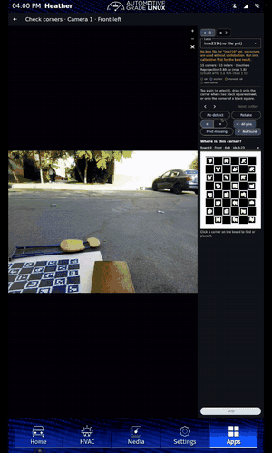
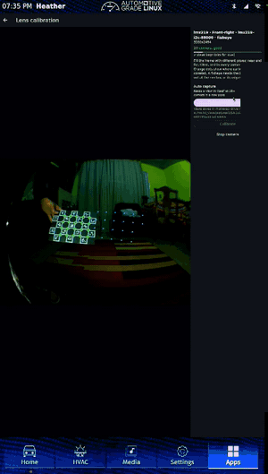

# What is Surround View

Surround View is a Flutter demo application that shows the car's cameras
live and stitched into a top-down bird's-eye view. Frames go from libcamera
to the GPU as dma-bufs with no copy on the CPU (if the hardware approves so), and the result is shown in
Flutter as a platform view of ivi-homescreen. Lens and surround calibration
are done inside the application.



A longer walkthrough is available as a
[video](https://abdulrahman-yasser.github.io/public/videos/surround-view-part1.mp4).

The application is built from one repository with three parts:

- `flutter-surround-view`: the Flutter user interface.
- `flutter/bev_view`: a Flutter plugin and `libbev_view.so`. It captures
  with libcamera, imports each frame into EGL and renders the camera or the
  stitched view in a shader.
- `flutter/bev_calib`: a Flutter plugin and `libbev_calib.so`. It runs the
  lens and surround calibration with OpenCV.

Source: [flutter-surround-view](https://github.com/Abdulrahman-Yasser/flutter-surround-view)

## Supported hardware

The application is tested on the Raspberry Pi 5 with two IMX219 cameras
(Raspberry Pi Camera Module 2) on the CAM0 and CAM1 connectors.

The cameras need the device tree overlays in `config.txt`. In the build's
`conf/local.conf` (or `site.conf`):

```
RPI_EXTRA_CONFIG = "\ndtoverlay=imx219,cam0\ndtoverlay=imx219,cam1\n"
```

On `raspberrypi5` the image uses the Raspberry Pi libcamera fork, which
supports the Pi 5 camera pipeline.

## Building

On `raspberrypi5`, the application is part of the Flutter demo image:

```
$ source {{ agl.codename }}/meta-agl/scripts/aglsetup.sh -m raspberrypi5 -b build-{{ agl.codename }} agl-demo agl-devel
$ bitbake agl-ivi-demo-flutter
```


## How to use

Start Surround View from the homescreen.

The toolbar at the bottom selects the view:

- **360 degree**: the stitched bird's-eye view of all mounted cameras.
- **Rear/Front cameras**: a single camera, seen straight on.
- **Guides** and **Distance grid**: overlays drawn over the view.
- **Snapshot**: saves the current view as a PNG.
- **Settings**: camera positions and calibration.

Before the 360 degree view shows anything, tell the application where each
camera is mounted and calibrate it.

### Camera positions

**Settings > Camera positions** lists the connected cameras. Pick a position
for each one (front, back, sides or corners). Cameras that are not used can
be left as **Not used**.

### Lens calibration

**Settings > Lens calibration** measures a lens so its distortion can be
removed. Pick a camera, choose **Pinhole** or **Fisheye**, and hold one
calibration board in front of the camera in many different poses. The result
is saved as a `<lens_model>-lens.ini` file and is used by every camera with
the same lens.



The full calibration, including the corrected camera view, is in this
[video](https://abdulrahman-yasser.github.io/public/videos/lens-calibration-part2.mp4).

### Surround calibration

**Settings > Surround calibration** places every camera into the top view.
Lay the boards around the car as in one of the provided layouts, pick that
layout, and let each camera find the boards in front of it. Where two
cameras see the same board, the application also measures how well their
seam lines up.

The calibration is saved to the application's `bev_config.ini`. The
**Settings** page shows where the configuration, lens files and layouts are
stored.

## Debugging

Set `BEV_STAT=1` to show the frame rate over each view, for example with a
systemd drop-in for the application's unit:

```
# /etc/systemd/system/agl-app-flutter@surround_view.service.d/stat.conf
[Service]
Environment=BEV_STAT=1
```

Then reload and restart:

```
$ systemctl daemon-reload
$ systemctl restart agl-app-flutter@surround_view
```

To check that the cameras are detected:

```
$ cam -l
```
